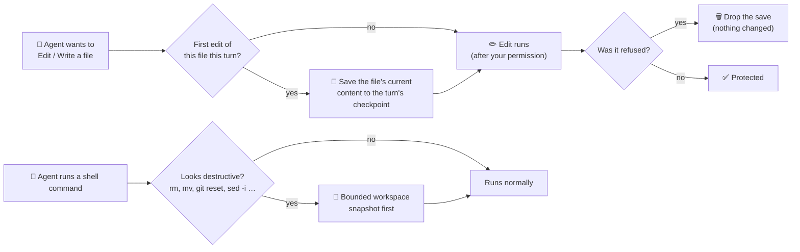
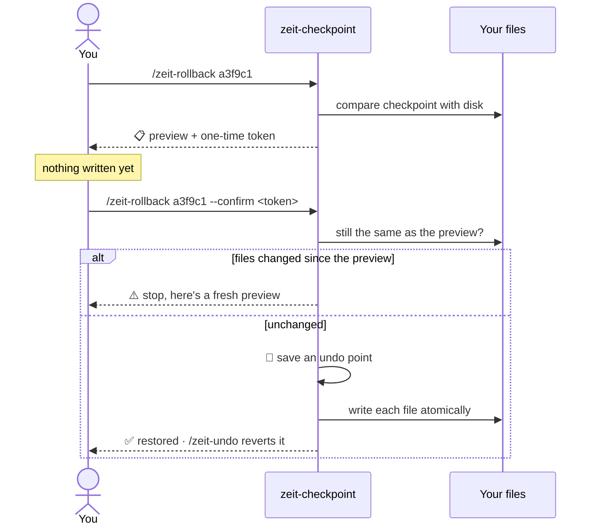
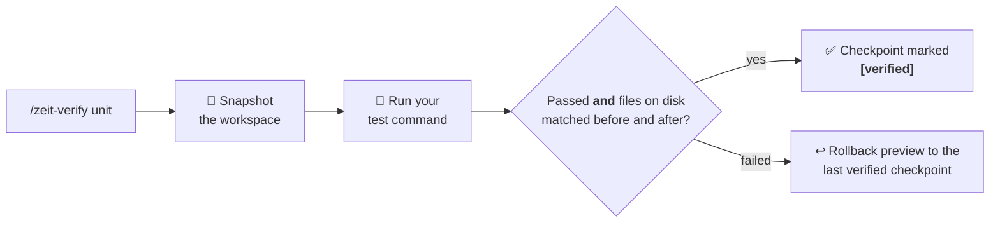
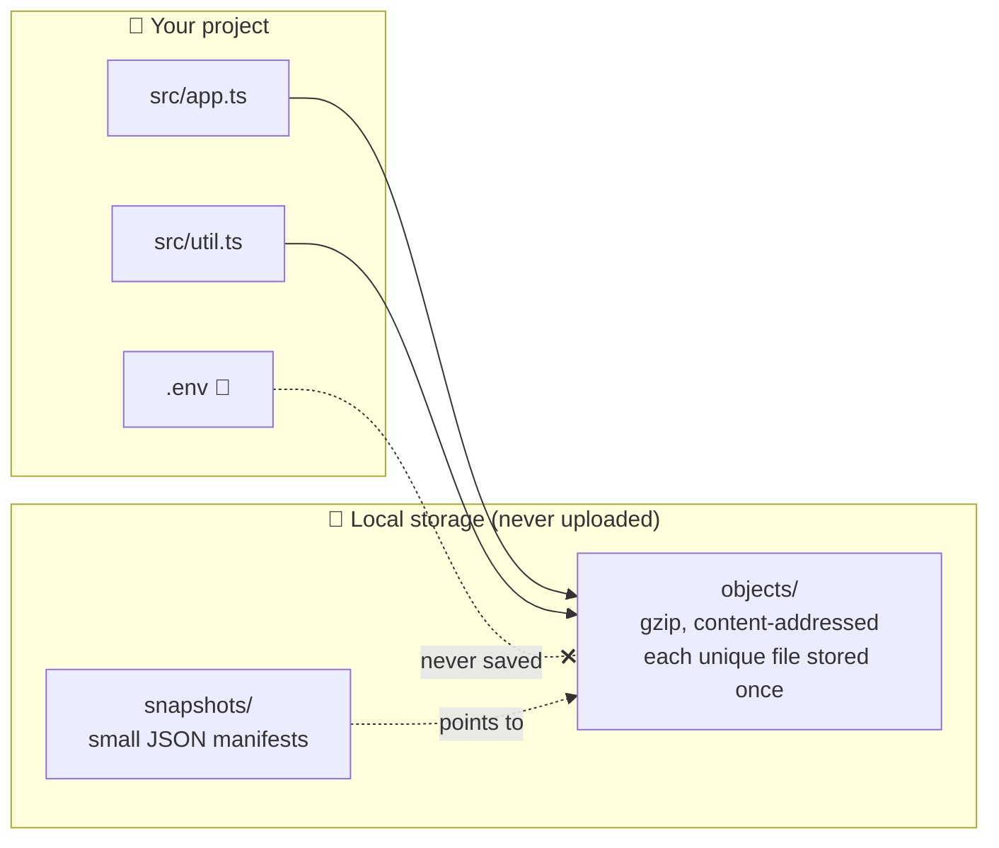

<div align="center">

# ⏱️ zeit-checkpoint

**An undo button for everything your Claude Code agent touches.**

Every file is saved before the agent edits it. Risky shell commands get a snapshot first.<br>
Any moment can be diffed, previewed and rolled back, with an undo point for the rollback itself.

[](https://github.com/zeitgeistz/zeit-checkpoint)
[](LICENSE)
[](https://nodejs.org)


[Install](#-install) · [How it works](#-how-it-works) · [Commands](#-commands) · [Timeline pane](#-the-timeline-pane) · [Configuration](#%EF%B8%8F-configuration) · [FAQ](#-faq)

</div>

---

## 🤔 Why

Agents are fast, and sometimes fast in the wrong direction: a refactor that breaks three files, an `rm -rf` in the wrong folder, a "cleanup" that deletes your uncommitted work. Git only protects what you committed.

**zeit-checkpoint protects what Git doesn't**: uncommitted edits, untracked files, and the state *between* commits. It runs quietly as you work and never touches your Git index, branches or commits.

<table>
<tr>
<td width="50%" valign="top">

### ❌ Without it
- Agent rewrites a file → old version gone unless committed
- `git checkout .` or `rm` → uncommitted work lost
- "Which change broke the tests?" → guesswork
- Undo = hunting through scrollback

</td>
<td width="50%" valign="top">

### ✅ With it
- Every edited file saved *before* the first edit
- Snapshot taken *before* the risky shell command runs
- Tests mark a checkpoint **verified**; failures offer a rollback
- Rollback = preview → confirm → undo point saved

</td>
</tr>
</table>

---

## 📦 Install

At the prompt of a Claude Code terminal session:

```
/plugin install zeit-checkpoint --marketplace zeitgeistz/zeit-checkpoint
```

Answer **`y`** to add the marketplace, then press **Enter** for user scope. It's active immediately.

<details>
<summary><b>Other ways to install</b></summary>

**From a shell:**

```
claude plugin install zeit-checkpoint --marketplace zeitgeistz/zeit-checkpoint
```

**In the desktop app** (where `/plugin` doesn't run): click **+** next to the prompt box → **Plugins** → **Add marketplace** with `zeitgeistz/zeit-checkpoint` → **Add plugin**.

**From a clone, for development:**

```
claude --plugin-dir /path/to/zeit-checkpoint
```

</details>

> **Requires:** Node.js on your `PATH` (the storage helper is a single, dependency-free Node script). Git is needed only for `/zeit-fork`.

---

## 🧭 How it works

### 1. Automatic protection while the agent works



Files that didn't exist before the edit are recorded too, so rolling back removes them.

### 2. Always know what's covered

A line above your prompt shows, at a glance, what is protected right now:

```text
zeit · last checkpoint b0b0b0 "before edits" · auto · 14:32 · 3 files
zeit · this turn: 3 file(s) protected in b0b0b0
zeit · not protected: .env (secret), ../shared/config.json (outside-project)
zeit · shell snapshot c4d1e9 before "git reset --hard HEAD~1": 412 files
```

Nothing is silently skipped. If a file isn't saved, you see it and why.

### 3. Roll back safely: preview, confirm, undo



What a preview looks like:

```text
Rollback preview for a3f9c1 "before refactor" (3 file(s)):
  overwrite src/app.ts
  recreate  src/util.ts
  DELETE    src/new-helper.ts (new since the checkpoint)
Unchanged: 125. 1 file(s) will be DELETED. An undo point is saved before anything is written.
Confirm: /zeit-rollback a3f9c1 --delete-new --confirm 9f2c4e1ab03d
```

| Action | Meaning |
| :-- | :-- |
| `overwrite` | File exists but differs; it gets the checkpoint's content |
| `recreate` | File was deleted since; it comes back |
| `DELETE` | File is new since the checkpoint; removed **only** with `--delete-new` |
| `blocked` | Can't be restored safely (shown with the reason) |

### 4. Verified checkpoints: know which state was good



It also watches the shell: when the agent runs one of *your* test commands and it fails, you get a toast pointing to the last verified checkpoint.

---

## ⌨️ Commands

| | Command | What it does |
| :-: | :-- | :-- |
| 📸 | `/zeit-checkpoint [label]` | Snapshot the whole workspace now |
| 📜 | `/zeit-checkpoints [count]` | List checkpoints, newest first, **across all sessions** |
| 🔍 | `/zeit-diff <id> [path...]` | What changed since a checkpoint |
| ↩️ | `/zeit-rollback <id> [path...] [--delete-new]` | Preview a restore, then confirm with the printed token |
| 🔁 | `/zeit-undo` | Preview undoing the last rollback, then confirm |
| 🗂️ | `/zeit-timeline` | Open the visual timeline pane |
| 🧪 | `/zeit-verify [name] [--checkpoint id]` | Run a test command and verify the checkpoint it tested |
| 🌿 | `/zeit-fork <id> [dest] [--branch name]` | Open a checkpoint in its own Git worktree and branch |
| 📦 | `/zeit-export <id> [out.zip] [--force]` | Save a checkpoint as a zip |
| 📌 | `/zeit-pin <id>` · `/zeit-unpin <id>` | Keep a checkpoint forever, or release it |
| 🧹 | `/zeit-prune` | Apply retention now |

**Referring to a checkpoint:** use the 6-character short id shown everywhere (`a3f9c1`), the full id, **`latest`** (newest checkpoint) or **`undo`** (newest undo point).

### Kinds of checkpoints you'll see

| Kind | Made by | Contains |
| :-- | :-- | :-- |
| `auto` | the agent's first edit of each file in a turn | just the files that turn touched |
| `shell` | a destructive-looking shell command | a bounded snapshot of the workspace |
| `manual` | `/zeit-checkpoint` or **New checkpoint** in the pane | the whole workspace |
| `test` | `/zeit-verify` | the whole workspace, `[verified]` if tests passed on it |
| `undo` | every rollback, just before it writes | the files the rollback replaced |

---

## 🗂️ The timeline pane

`/zeit-timeline` opens a pane where everything is a click or a key away:

```text
┌─ Checkpoints ─────────────────────────────────────────────────────────────┐
│ [ Refresh ] [ New checkpoint ] [ Undo last rollback ]                     │
│                                                                           │
│ > a3f9c1 14:02 manual 128 files before refactor [pinned]                  │
│   b0b0b0 14:32 auto   3 files   before edits                              │
│   7e57ed 14:40 test   128 files test: unit [verified]                     │
│                                                                           │
│ a3f9c1 "before refactor" · whole workspace · 2 file(s) differ from now    │
│ [ Diff all ] [ Restore all… ] [ Restore exactly (delete new files)… ]     │
│ [ Pin ] [ Verify with tests ] [ Fork to worktree ] [ Export zip ]         │
│   changed  src/app.ts                                                     │
│   deleted  src/util.ts                                                    │
│                                                                           │
│ src/app.ts modified since                                                 │
│ @@ -12,3 +12,3 @@                                                         │
│    const port = 3000                                                      │
│ -  app.listen(port)                                                       │
│ +  app.listen(port, '0.0.0.0')                                            │
└───────────────────────────────────────────────────────────────────────────┘
```

| Key | Action | | Key | Action |
| :-: | :-- | - | :-: | :-- |
| `r` | Refresh | | `p` | Pin / Unpin |
| `n` | New checkpoint | | `v` | Verify with tests |
| `u` | Undo last rollback | | `f` | Fork to worktree |
| `d` | Diff all | | `e` | Export zip |
| `a` | Restore all… | | | |

Click a file row to see its diff, then **Restore &lt;file&gt;…** to roll back just that one file.

---

## ⚙️ Configuration

Everything works with zero config. To customise, add a `.zeit.json` to your project root:

```jsonc
{
  // Test commands for /zeit-verify, and watched in the shell
  "tests": { "unit": "npm test", "lint": "npm run lint" },
  "testTimeoutSec": 540,

  // Extra files to never save (globs)
  "ignore": ["fixtures/large/**", "*.sqlite"],

  // Extra shell commands that trigger a snapshot (regular expressions)
  "shellPatterns": ["\\bmake\\s+clean\\b"],

  // Size limits: full snapshots / snapshots before shell commands
  "limits":      { "maxFiles": 20000, "maxFileMB": 20, "maxTotalMB": 500 },
  "shellLimits": { "maxFiles": 5000,  "maxFileMB": 5,  "maxTotalMB": 200 },

  // Retention: whichever limit is hit first
  "retention": { "maxAgeDays": 14, "maxCount": 300, "maxMB": 2048 }
}
```

> The file must be plain JSON: the comments above are for explanation only. The numbers shown are the defaults.

---

## 🔒 What's saved, and where



| | |
| :-- | :-- |
| 📂 **Project** | The Git top-level folder, or the working directory outside Git |
| 📋 **Files** | In Git: tracked + untracked, **respecting `.gitignore`**. Outside Git: everything except `node_modules`, `.venv`, `dist`, `build`, `target` and caches |
| 🚫 **Never saved** | `.env*` (except `.example`/`.sample`/`.template`), `*.pem`, `*.key`, `*.p12`, `*.pfx`, `*.jks`, `*.keystore`, `id_rsa` & co., `.npmrc`, `.pypirc`, `.netrc`, `.git` internals, your `ignore` globs |
| 💽 **Storage** | Windows: `%LOCALAPPDATA%\zeit-checkpoints` · macOS/Linux: `$XDG_DATA_HOME/zeit-checkpoints` or `~/.local/share/zeit-checkpoints` · override with `ZEIT_HOME` |
| 🧬 **Dedup** | Unchanged files are stored once, however many checkpoints hold them |
| ✍️ **Writes** | Undo point first, then each file written to a temp file and renamed into place |
| 🧹 **Retention** | Pruned by age, count and size; **pinned** and the **newest verified** checkpoint are always kept |

---

## ❓ FAQ

<details>
<summary><b>Does it change my Git repository?</b></summary>

No. It reads the file list from Git but never stages, commits, resets or switches branches. `/zeit-fork` is the only command that touches Git: it adds a *new* worktree on a *new* branch and leaves your current one alone.
</details>

<details>
<summary><b>What happens if a rollback is interrupted?</b></summary>

The undo point is saved before any file is written, so `/zeit-undo` brings back the exact state from before the rollback started.
</details>

<details>
<summary><b>Will a rollback delete files I created afterwards?</b></summary>

Not by default. New files are kept unless you pass `--delete-new` (or choose **Restore exactly** in the pane), and the preview lists every file that would be deleted before you confirm.
</details>

<details>
<summary><b>What if I edit a file between the preview and the confirm?</b></summary>

The token no longer matches: the restore stops and shows a fresh preview of what's true now.
</details>

<details>
<summary><b>How much disk does it use?</b></summary>

Files are gzip-compressed and deduplicated by content, and retention keeps storage under 2 GB by default (`retention.maxMB`). `/zeit-prune` applies it on demand.
</details>

<details>
<summary><b>Can I see checkpoints from earlier sessions?</b></summary>

Yes. Checkpoints belong to the project, not the session: `/zeit-checkpoints` and the timeline show all of them.
</details>

---

## 🛠️ Development

```bash
node --test "test/*.spec.mjs"   # storage helper: 30 acceptance tests in disposable temp folders
claude plugin test .            # mod: 29 tests for commands, the band and the timeline pane
claude plugin validate .        # manifest + hooks module
```

```text
zeit-checkpoint/
├── bin/zeit.mjs          storage helper: snapshot, diff, preview/restore, retention, test, fork, export
├── hooks/
│   ├── register.tsx      commands and the band above the prompt
│   ├── capture.ts        first-touch edit capture, shell snapshots, failing-test watch
│   └── timeline.tsx      the timeline pane
├── types/index.d.ts      the mod's session state
└── test/                 helper acceptance tests
```

## 📄 License

[MIT](LICENSE) © zeitgeistz
