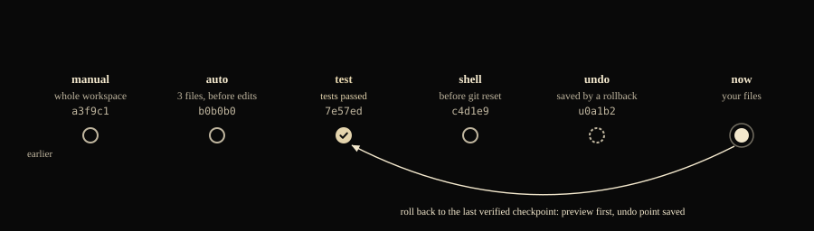
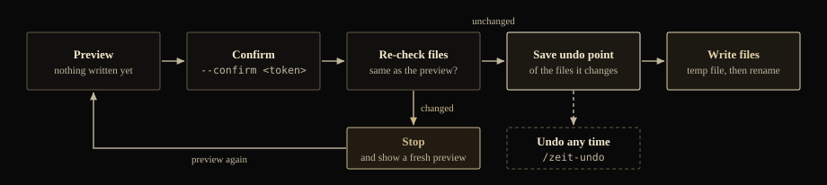
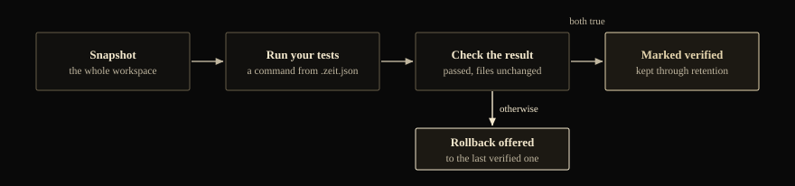

<div align="center">

# zeit-checkpoint

**An undo button for everything your Claude Code agent touches.**

Every file is saved before the agent edits it, risky shell commands get a snapshot first,<br>
and any moment can be diffed, previewed and rolled back, with an undo point for the rollback itself.

[](https://github.com/zeitgeistz/zeit-checkpoint)
[](LICENSE)
[](https://nodejs.org)


[Install](#install) · [How it works](#how-it-works) · [Commands](#commands) · [Timeline pane](#the-timeline-pane) · [Configuration](#configuration) · [FAQ](#faq)

<br>

<picture>
  <source media="(prefers-color-scheme: dark)" srcset="docs/timeline-dark.svg">
  
</picture>

</div>

## Why

Agents are fast, and sometimes fast in the wrong direction: a refactor that breaks three files, an `rm -rf` in the wrong folder, a cleanup that deletes uncommitted work. Git only protects what you committed.

zeit-checkpoint protects what Git doesn't: uncommitted edits, untracked files, and the state between commits. It runs quietly while you work and never touches your Git index, branches or commits. Nothing leaves your machine.

| Without it | With it |
| :-- | :-- |
| An agent rewrites a file and the old version is gone unless committed | Every edited file is saved before its first edit |
| `git checkout .` or `rm` loses uncommitted work | A snapshot is taken before the risky command runs |
| "Which change broke the tests?" is guesswork | Passing tests mark a checkpoint **verified**; failures offer a rollback to it |
| Undo means hunting through scrollback | Rollback is preview, confirm, with an undo point saved first |

## Install

At the prompt of a Claude Code terminal session:

```
/plugin install zeit-checkpoint --marketplace zeitgeistz/zeit-checkpoint
```

Answer `y` to add the marketplace, then press Enter for user scope. It is active immediately.

<details>
<summary>Other ways to install</summary>

<br>

**From a shell**

```
claude plugin install zeit-checkpoint --marketplace zeitgeistz/zeit-checkpoint
```

**In the desktop app**, where `/plugin` doesn't run: click **+** next to the prompt box, then **Plugins**, **Add marketplace** with `zeitgeistz/zeit-checkpoint`, then **Add plugin**.

**From a clone, for development**

```
claude --plugin-dir /path/to/zeit-checkpoint
```

</details>

**Requires** Node.js on your `PATH`: the storage helper is a single, dependency-free Node script. Git is needed only for `/zeit-fork`.

## How it works

### 1. Protection while the agent works

<picture>
  <source media="(prefers-color-scheme: dark)" srcset="docs/capture-dark.svg">
  
</picture>

Files that did not exist before the edit are recorded too, so a rollback removes them. The shell patterns cover `rm`, `del`, `mv`, `Remove-Item`, `git reset/checkout/clean/stash/rebase/…`, `sed -i`, `find -delete`, output redirects and more; projects can add their own.

### 2. Always know what is covered

A few lines above the prompt show what is protected right now:

```text
zeit · last checkpoint b0b0b0 "before edits" · auto · 14:32 · 3 files
zeit · this turn: 3 file(s) protected in b0b0b0
zeit · not protected: .env (secret), ../shared/config.json (outside-project)
zeit · shell snapshot c4d1e9 before "git reset --hard HEAD~1": 412 files
```

Nothing is skipped silently: if a file was not saved, you see it and why.

### 3. Roll back safely

<picture>
  <source media="(prefers-color-scheme: dark)" srcset="docs/rollback-dark.svg">
  
</picture>

A preview, before anything is written:

```text
Rollback preview for a3f9c1 "before refactor" (3 file(s)):
  overwrite src/app.ts
  recreate  src/util.ts
  DELETE    src/new-helper.ts (new since the checkpoint)
Unchanged: 125. 1 file(s) will be DELETED. An undo point is saved before anything is written.
Confirm: /zeit-rollback a3f9c1 --delete-new --confirm 9f2c4e1ab03d
```

| Action | Meaning |
| :-- | :-- |
| `overwrite` | The file exists but differs; it gets the checkpoint's content |
| `recreate` | The file was deleted since; it comes back |
| `DELETE` | The file is new since the checkpoint; removed only with `--delete-new` |
| `blocked` | Cannot be restored safely; the reason is shown |

### 4. Verified checkpoints

<picture>
  <source media="(prefers-color-scheme: dark)" srcset="docs/verify-dark.svg">
  
</picture>

A checkpoint is verified only when the tests pass **and** the files on disk matched it exactly before and after the run, so a verified checkpoint always means "this exact state passed". The mod also watches the shell: when the agent runs one of your test commands and it fails, a toast points to the last verified checkpoint.

## Commands

| Command | What it does |
| :-- | :-- |
| `/zeit-checkpoint [label]` | Snapshot the whole workspace now |
| `/zeit-checkpoints [count]` | List checkpoints, newest first, across all sessions |
| `/zeit-diff <id> [path...]` | Show what changed since a checkpoint |
| `/zeit-rollback <id> [path...] [--delete-new]` | Preview a restore, then confirm with the printed token |
| `/zeit-undo` | Preview undoing the last rollback, then confirm |
| `/zeit-timeline` | Open the timeline pane |
| `/zeit-verify [name] [--checkpoint id]` | Run a test command and verify the checkpoint it tested |
| `/zeit-fork <id> [dest] [--branch name]` | Open a checkpoint in its own Git worktree and branch |
| `/zeit-export <id> [out.zip] [--force]` | Save a checkpoint as a zip |
| `/zeit-pin <id>`, `/zeit-unpin <id>` | Keep a checkpoint through retention, or release it |
| `/zeit-prune` | Apply retention now |

An `<id>` is the six-character short id shown everywhere (`a3f9c1`), a full id, `latest` (the newest checkpoint) or `undo` (the newest undo point).

**Kinds of checkpoint**

| Kind | Made by | Contains |
| :-- | :-- | :-- |
| `auto` | the agent's first edit of each file in a turn | the files that turn touched |
| `shell` | a destructive-looking shell command | a bounded snapshot of the workspace |
| `manual` | `/zeit-checkpoint`, or **New checkpoint** in the pane | the whole workspace |
| `test` | `/zeit-verify` | the whole workspace, `[verified]` if the tests passed on it |
| `undo` | every rollback, just before it writes | the files the rollback replaced |

## The timeline pane

`/zeit-timeline` opens a pane where every action is a click or a key away:

```text
┌─ Checkpoints ─────────────────────────────────────────────────────────────┐
│ [ Refresh ] [ New checkpoint ] [ Undo last rollback ]                     │
│                                                                           │
│ > a3f9c1 14:02 manual 128 files before refactor [pinned]                  │
│   b0b0b0 14:32 auto   3 files   before edits                              │
│   7e57ed 14:40 test   128 files test: unit [verified]                     │
│                                                                           │
│ a3f9c1 "before refactor" · whole workspace · 2 file(s) differ from now    │
│ [ Diff all ] [ Restore all… ] [ Restore exactly (delete new files)… ]     │
│ [ Pin ] [ Verify with tests ] [ Fork to worktree ] [ Export zip ]         │
│   changed  src/app.ts                                                     │
│   deleted  src/util.ts                                                    │
│                                                                           │
│ src/app.ts modified since                                                 │
│ @@ -12,3 +12,3 @@                                                         │
│    const port = 3000                                                      │
│ -  app.listen(port)                                                       │
│ +  app.listen(port, '0.0.0.0')                                            │
└───────────────────────────────────────────────────────────────────────────┘
```

| Key | Action | Key | Action |
| :-: | :-- | :-: | :-- |
| `r` | Refresh | `p` | Pin or unpin |
| `n` | New checkpoint | `v` | Verify with tests |
| `u` | Undo last rollback | `f` | Fork to worktree |
| `d` | Diff all | `e` | Export zip |
| `a` | Restore all… | | |

Click a file row to see its diff, then **Restore &lt;file&gt;…** to roll back that one file.

## Configuration

Everything works with no configuration. To customise, add a `.zeit.json` to the project root:

```jsonc
{
  // Test commands for /zeit-verify, also watched in the shell
  "tests": { "unit": "npm test", "lint": "npm run lint" },
  "testTimeoutSec": 540,

  // Extra files never to save (globs)
  "ignore": ["fixtures/large/**", "*.sqlite"],

  // Extra shell commands that trigger a snapshot (regular expressions)
  "shellPatterns": ["\\bmake\\s+clean\\b"],

  // Size limits: full snapshots, and snapshots before shell commands
  "limits":      { "maxFiles": 20000, "maxFileMB": 20, "maxTotalMB": 500 },
  "shellLimits": { "maxFiles": 5000,  "maxFileMB": 5,  "maxTotalMB": 200 },

  // Retention: whichever limit is reached first
  "retention": { "maxAgeDays": 14, "maxCount": 300, "maxMB": 2048 }
}
```

The file must be plain JSON; the comments are only for explanation here. The numbers shown are the defaults.

## What is saved, and where

<picture>
  <source media="(prefers-color-scheme: dark)" srcset="docs/storage-dark.svg">
  
</picture>

| | |
| :-- | :-- |
| **Project** | The Git top-level folder, or the working directory outside Git |
| **Files** | In Git: tracked and untracked files, respecting `.gitignore`. Outside Git: everything except `node_modules`, `.venv`, `dist`, `build`, `target` and caches |
| **Never saved** | `.env*` (except `.example`, `.sample`, `.template`), `*.pem`, `*.key`, `*.p12`, `*.pfx`, `*.jks`, `*.keystore`, `id_rsa` and similar keys, `.npmrc`, `.pypirc`, `.netrc`, `.git` internals, and your `ignore` globs |
| **Writes** | The undo point first, then each file written to a temporary file and renamed into place |
| **Retention** | Pruned by age, count and size; pinned checkpoints and the newest verified one are always kept |

## FAQ

<details>
<summary><b>Does it change my Git repository?</b></summary>
<br>
No. It reads the file list from Git but never stages, commits, resets or switches branches. <code>/zeit-fork</code> is the only command that touches Git: it adds a new worktree on a new branch and leaves the current one alone.
</details>

<details>
<summary><b>What happens if a rollback is interrupted?</b></summary>
<br>
The undo point is saved before any file is written, so <code>/zeit-undo</code> brings back the exact state from before the rollback started.
</details>

<details>
<summary><b>Will a rollback delete files I created afterwards?</b></summary>
<br>
Not by default. New files are kept unless you pass <code>--delete-new</code> (or choose <b>Restore exactly</b> in the pane), and the preview lists every file that would be deleted before you confirm.
</details>

<details>
<summary><b>What if I edit a file between the preview and the confirm?</b></summary>
<br>
The token no longer matches: the restore stops and shows a fresh preview of what is true now.
</details>

<details>
<summary><b>How much disk does it use?</b></summary>
<br>
Files are gzip-compressed and stored once by content, and retention keeps storage under 2 GB by default (<code>retention.maxMB</code>). <code>/zeit-prune</code> applies it on demand.
</details>

<details>
<summary><b>Can I see checkpoints from earlier sessions?</b></summary>
<br>
Yes. Checkpoints belong to the project, not the session: <code>/zeit-checkpoints</code> and the timeline show all of them.
</details>

## Development

```bash
node --test "test/*.spec.mjs"   # storage helper: 30 acceptance tests in disposable temp folders
claude plugin test .            # mod: 29 tests for commands, the band and the timeline pane
claude plugin validate .        # manifest and hooks module
node docs/diagrams.mjs docs     # redraw the README diagrams
```

```text
zeit-checkpoint/
├── bin/zeit.mjs          storage helper: snapshot, diff, preview/restore, retention, test, fork, export
├── hooks/
│   ├── register.tsx      commands and the lines above the prompt
│   ├── capture.ts        first-touch edit capture, shell snapshots, failing-test watch
│   └── timeline.tsx      the timeline pane
├── types/index.d.ts      the mod's session state
├── docs/                 README diagrams and the script that draws them
└── test/                 helper acceptance tests
```

## License

[MIT](LICENSE) © zeitgeistz
